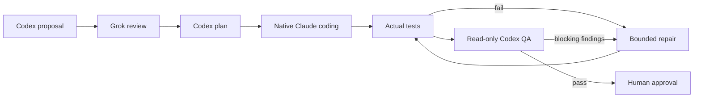
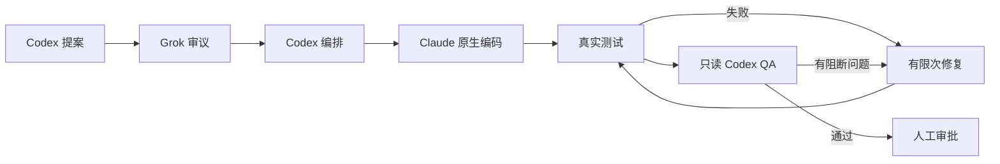

# 贞观·政事堂 · Concord

**English** · [中文](#中文)

A Claude Code plugin (v0.2.2) that runs a multi-model review-and-QA workflow inside your current session. Codex proposes and plans, Grok reviews, Claude writes the code, your real tests decide, and a read-only Codex QA gates the result. You stay the final authority.



## Install from GitHub

Interactive, inside Claude Code:

```text
/plugin marketplace add radowitz/concord-plugin
/plugin install concord@concord-plugin
```

Equivalent CLI, user scope:

```bash
claude plugin marketplace add radowitz/concord-plugin
claude plugin install concord@concord-plugin --scope user
```

Once installed, the plugin loads in future sessions.

**Requirements:** Node 18+, Git, Claude Code, and logged-in `codex` and `grok` CLIs.

## Usage

```text
/concord:run add server-side validation to the signup form
/concord:run                # bare: uses the task from the current conversation
/concord:status            # steps, providers/models, artifacts, next action
/concord:resume latest     # after a restart; re-runs nothing on its own
/concord:logs              # live or finished Codex/Grok/test output of a running stage
```

## Design

- **Model routing:** each task gets a `haiku`, `sonnet` or `opus` alias based on risk (override with `--tier worker=…`).
- **Serial, dirty-tolerant start:** a run can start on a checkout with uncommitted work. That work is snapshotted as the baseline and preserved; only the unrelated baseline work is excluded from the change diff, and QA may still flag an existing defect that blocks the requested outcome. Implementation is serial. Opt in to a clean-only start with `--require-clean`.
- **Auto-detected checks:** no `--test` needed. Concord reads the nearest `package.json` (scripts, `packageManager`, lockfiles for npm/pnpm/yarn/bun) and runs `<pm> run test|check|typecheck|lint|build` as argv, skipping placeholders and watch scripts. If nothing reliable exists it asks instead of passing. A typecheck/lint/build gate is reported as such, not as tests. `--test` is an optional override.
- **Bound to its worktree:** a run is tied to the checkout it started in. Mutating commands from another worktree of the same repository fail with `wrong_worktree` before anything is written; read-only views label such a run as foreign instead of comparing the wrong files.
- **Checks run where you meant:** explicit checks run in the directory you started from (optional `tests_cwd` for root commands); the cwd is recorded and shown. After planning, Concord warns when planned files lie outside what the check can be shown to cover; it never adds checks or claims coverage it cannot prove.
- **Changing the goal mid-run:** the host records a new requirement with an internal `amend` (revision, history, validation invalidated, edits kept; scope changes get a fresh Grok review, then re-plan). Claude Code does support `UserPromptSubmit` hooks, but this plugin registers no hooks, so nothing intercepts chat automatically: the host amends only when the skill instructs it to and it judges your message modifies the active task (best-effort host behaviour, not guaranteed). Ordinary chat is not meant to amend.
- **Waiting and visibility:** Codex/Grok steps get 1800 s by default (`0` = wait manually; `extend` changes it while running). Soft 30 s notices never kill a step. Stages run as labelled background Bash tasks in `/tasks`; Codex/Grok stay external CLIs, not native Claude agents. Raw stdout/stderr and normalised events (Codex `--json`, Grok `streaming-json`) are logged as they arrive and readable with `/concord:logs` while the stage runs.
- **Repair routing:** repairs inherit the highest relevant task tier (Opus for high risk) unless `--tier repair=…` is set.
- **Light footprint:** no daemon, no Python, no npm; Node builtins only.
- **Human in control:** no automatic commit, push or deploy.
- **Validation:** [verification record](docs/verification.md): 93 deterministic tests passed. One real native headless Claude Code task completed Codex → Grok → Codex → main-session implementation → project tests → Codex QA in about 132 s, preserving pre-existing files and HEAD. Interactive UI, native Agent execution and real long-wait controls remain unverified.

## From source

```bash
claude --plugin-dir ./plugins/concord
node --test tests/claude_plugin.test.mjs
```

Docs: [detailed plugin README](plugins/concord/README.md) · [MIT License](LICENSE)

---

## 中文

Claude Code 插件（v0.2.2），在当前会话中运行多模型审议与 QA 流程：Codex 提案与编排，Grok 审议，Claude 原生编码，真实测试裁决，只读 Codex QA 把关。人始终拥有最终决定权。



## 从 GitHub 安装

在 Claude Code 中交互安装：

```text
/plugin marketplace add radowitz/concord-plugin
/plugin install concord@concord-plugin
```

等价的命令行（用户级）：

```bash
claude plugin marketplace add radowitz/concord-plugin
claude plugin install concord@concord-plugin --scope user
```

安装后，插件会在以后的会话中自动加载。

**要求：** Node 18+、Git、Claude Code，以及已登录的 `codex` 和 `grok` CLI。

## 用法

```text
/concord:run 为注册表单增加服务端校验
/concord:run                # 不带参数：使用当前对话中的任务
/concord:status            # 步骤、模型、产物、下一步
/concord:resume latest     # 重启后恢复；不会自动重跑
/concord:logs              # 查看运行中或已结束阶段的 Codex/Grok/测试输出
```

## 设计

- **模型路由：** 按风险为每个任务选择 `haiku`、`sonnet` 或 `opus` 别名（可用 `--tier worker=…` 覆盖）。
- **串行、可在脏工作区开始：** 工作区有未提交改动也可开始；这些改动被快照为基线并原样保留，变更 diff 与快速策略只统计运行期间的新改动，无关的原有工作不计入；若原有缺陷妨碍所请求的结果，QA 仍可将其列为问题。串行实现。需要仅在干净工作区开始时，可显式加 `--require-clean`。
- **自动检测检查命令：** 无需 `--test`。读取最近的 `package.json`（scripts、`packageManager`、npm/pnpm/yarn/bun 锁文件），以 argv 运行 `<pm> run test|check|typecheck|lint|build`，跳过占位与 watch 脚本；找不到可靠命令时会询问而不是放行。仅 typecheck/lint/build 时会如实标注并非测试。`--test` 为可选覆盖。
- **绑定工作树：** 任务绑定其启动时的检出目录。同一仓库的其他 worktree 上的变更型命令会在写入任何内容之前以 `wrong_worktree` 拒绝；只读命令会把该任务标为“外部”，而不是拿错误的文件去比对。
- **检查在预期目录运行：** 显式检查在启动时所在目录运行（根目录命令可用 `tests_cwd`），目录会被记录并显示。规划后若计划文件超出检查可证明覆盖的范围会给出警告；绝不自动加检查，也不声称无法证明的覆盖。
- **任务中途改需求：** 宿主通过内部 `amend` 记录新需求（修订号、历史、使验证失效、保留已有改动；范围变化会先重新经 Grok 审议再重新规划）。Claude Code 支持 `UserPromptSubmit` 钩子，但本插件未注册任何钩子，因此不会自动拦截聊天：只有技能指示宿主、且宿主判断你的消息修改了进行中的任务时才会调用（尽力而为的宿主行为，不保证）。普通聊天不应触发。
- **等待与可见性：** Codex/Grok 每步默认 1800 秒（`0` 为手动等待；运行中可用 `extend` 调整）。每 30 秒的提示只是通知，不会终止步骤。各阶段作为带标签的后台 Bash 任务出现在 `/tasks`；Codex/Grok 仍是外部 CLI，不是原生 Claude 代理。原始 stdout/stderr 与规范化事件（Codex `--json`、Grok `streaming-json`）实时落盘，运行期间即可用 `/concord:logs` 查看。
- **修复路由：** 修复默认继承相关任务中最高的档位（高风险为 Opus），除非指定 `--tier repair=…`。
- **轻量：** 无守护进程、无 Python、无 npm，仅用 Node 内置模块。
- **人工掌控：** 不会自动 commit、push 或部署。
- **验证：** 详见 [验证记录](docs/verification.md)。93 项确定性测试通过；一次真实原生无界面任务约 132 秒完成 Codex → Grok → Codex → Claude 主会话编码 → 项目测试 → Codex QA，已有文件与 HEAD 保持不变。交互面板、原生 Agent 执行和真实长等待控制仍未验证。

## 从源码加载

```bash
claude --plugin-dir ./plugins/concord
node --test tests/claude_plugin.test.mjs
```

文档：[插件详细说明](plugins/concord/README.md) · [MIT 许可证](LICENSE)
