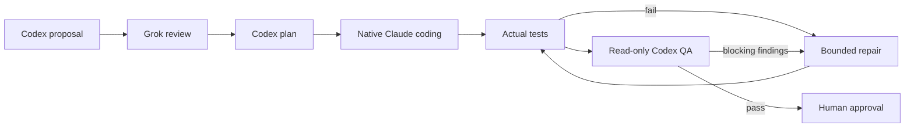

# 贞观·政事堂 · Concord

**English** · [简体中文](README.zh-CN.md)

A Claude Code plugin (v0.2.2) that runs a multi-model review-and-QA workflow inside your current session. Codex proposes and plans, Grok reviews, Claude writes the code, your real tests decide, and a read-only Codex QA gates the result. You stay the final authority.



## Install from GitHub

Interactive, inside Claude Code:

```text
/plugin marketplace add radowitz/concord-plugin
/plugin install concord@concord-plugin
```

Equivalent CLI, user scope:

```bash
claude plugin marketplace add radowitz/concord-plugin
claude plugin install concord@concord-plugin --scope user
```

Once installed, the plugin loads in future sessions.

**Requirements:** Node 18+, Git, Claude Code, and logged-in `codex` and `grok` CLIs.

## Usage

```text
/concord:run add server-side validation to the signup form
/concord:run                # bare: uses the task from the current conversation
/concord:status            # steps, providers/models, artifacts, next action
/concord:resume latest     # after a restart; re-runs nothing on its own
/concord:logs              # live or finished Codex/Grok/test output of a running stage
```

## Architecture

| Institution | Agent | Responsibility |
| --- | --- | --- |
| 中书省 | Codex | Understand the request and propose a solution |
| 门下省 | Grok | Independently review the proposal |
| 尚书省 | Codex | Plan tasks and dependencies |
| 六部 | Claude | Implement tasks and repairs |
| 御史台 | Codex + project checks | Review changes and verify results |
| 天子 | You | Accept the result and decide whether to publish |

These are organizational metaphors. The current plugin executes implementation tasks serially in your checkout.

## Design

- **Model routing:** each task gets a `haiku`, `sonnet` or `opus` alias based on risk (override with `--tier worker=…`).
- **Serial, dirty-tolerant start:** a run can start on a checkout with uncommitted work. That work is snapshotted as the baseline and preserved; only the unrelated baseline work is excluded from the change diff, and QA may still flag an existing defect that blocks the requested outcome. Implementation is serial. Opt in to a clean-only start with `--require-clean`.
- **Auto-detected checks:** no `--test` needed. Concord reads the nearest `package.json` (scripts, `packageManager`, lockfiles for npm/pnpm/yarn/bun) and runs `<pm> run test|check|typecheck|lint|build` as argv, skipping placeholders and watch scripts. If nothing reliable exists it asks instead of passing. A typecheck/lint/build gate is reported as such, not as tests. `--test` is an optional override.
- **Bound to its worktree:** a run is tied to the checkout it started in. Mutating commands from another worktree of the same repository fail with `wrong_worktree` before anything is written; read-only views label such a run as foreign instead of comparing the wrong files.
- **Checks run where you meant:** explicit checks run in the directory you started from (optional `tests_cwd` for root commands); the cwd is recorded and shown. After planning, Concord warns when planned files lie outside what the check can be shown to cover; it never adds checks or claims coverage it cannot prove.
- **Changing the goal mid-run:** the host records a new requirement with an internal `amend` (revision, history, validation invalidated, edits kept; scope changes get a fresh Grok review, then re-plan). Claude Code does support `UserPromptSubmit` hooks, but this plugin registers no hooks, so nothing intercepts chat automatically: the host amends only when the skill instructs it to and it judges your message modifies the active task (best-effort host behaviour, not guaranteed). Ordinary chat is not meant to amend.
- **Waiting and visibility:** Codex/Grok steps get 1800 s by default (`0` = wait manually; `extend` changes it while running). Soft 30 s notices never kill a step. Stages run as labelled background Bash tasks in `/tasks`; Codex/Grok stay external CLIs, not native Claude agents. Raw stdout/stderr and normalised events (Codex `--json`, Grok `streaming-json`) are logged as they arrive and readable with `/concord:logs` while the stage runs.
- **Repair routing:** repairs inherit the highest relevant task tier (Opus for high risk) unless `--tier repair=…` is set.
- **Light footprint:** no daemon, no Python, no npm; Node builtins only.
- **Human in control:** no automatic commit, push or deploy.
- **Validation:** [verification record](docs/verification.md): 93 deterministic tests passed. One real native headless Claude Code task completed Codex → Grok → Codex → main-session implementation → project tests → Codex QA in about 132 s, preserving pre-existing files and HEAD. Interactive UI, native Agent execution and real long-wait controls remain unverified.

## Failures, recovery and approval

Failed checks or blocking QA findings return to Claude for repair, followed by fresh checks and Codex QA. The default repair budget is two rounds. Exhausted repairs, malformed provider output and timeouts stop the run with its edits, logs and state preserved; they never count as approval.

After a session restart, use `/concord:resume latest` to inspect the interrupted run. Recovery does not silently rerun a model call; an interrupted stage requires an explicit retry. To change the requirement, tell Claude in the active conversation; the skill records an amendment and scope changes go back through Grok review and planning. This depends on the host following the skill, rather than an automatic chat hook.

Human approval records a decision for the exact validated working state. It does not start another coding cycle or commit, merge, push or deploy. Ask for those Git or deployment actions separately; subsequent edits require fresh validation.

## Versions

Current version: **v0.2.2**. See the [English changelog](CHANGELOG.md) or [中文更新日志](CHANGELOG.zh-CN.md) for every published version. Restart Claude Code after updating the installed plugin.

## From source

```bash
git clone https://github.com/radowitz/concord-plugin.git
cd concord-plugin
claude --plugin-dir ./plugins/concord
node --test tests/claude_plugin.test.mjs
```

Docs: [detailed plugin README](plugins/concord/README.md) · [MIT License](LICENSE)
