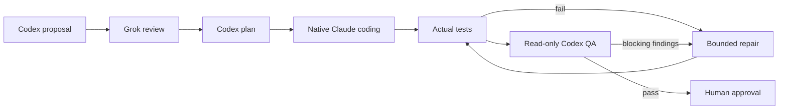
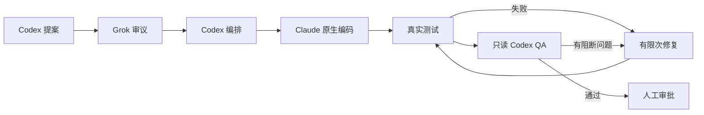

# 贞观·政事堂 · Concord

**English** · [中文](#中文)

A Claude Code plugin (v0.2.0) that runs a multi-model review-and-QA workflow inside your current session. Codex proposes and plans, Grok reviews, Claude writes the code, your real tests decide, and a read-only Codex QA gates the result. You stay the final authority.



## Install from GitHub

Interactive, inside Claude Code:

```text
/plugin marketplace add radowitz/concord-plugin
/plugin install concord@concord-plugin
```

Equivalent CLI, user scope:

```bash
claude plugin marketplace add radowitz/concord-plugin
claude plugin install concord@concord-plugin --scope user
```

Once installed, the plugin loads in future sessions.

**Requirements:** Node 18+, Git, Claude Code, and logged-in `codex` and `grok` CLIs.

## Usage

```text
/concord:run --test 'npm test' add server-side validation to the signup form
/concord:status            # steps, providers/models, artifacts, next action
/concord:resume latest     # after a restart; re-runs nothing on its own
```

## Design

- **Model routing:** each task gets a `haiku`, `sonnet` or `opus` alias based on risk (override with `--tier worker=…`).
- **Serial, clean checkout:** a run starts only on a clean checkout and implements serially.
- **Light footprint:** no daemon, no Python, no npm; Node builtins only.
- **Human in control:** no automatic commit, push or deploy.
- **Validation:** 33 mock tests; real model catalogs checked; no real-model E2E run.

## From source

```bash
claude --plugin-dir ./plugins/concord
node --test tests/claude_plugin.test.mjs
```

Docs: [detailed plugin README](plugins/concord/README.md) · [MIT License](LICENSE)

---

## 中文

Claude Code 插件（v0.2.0），在当前会话中运行多模型审议与 QA 流程：Codex 提案与编排，Grok 审议，Claude 原生编码，真实测试裁决，只读 Codex QA 把关。人始终拥有最终决定权。



## 从 GitHub 安装

在 Claude Code 中交互安装：

```text
/plugin marketplace add radowitz/concord-plugin
/plugin install concord@concord-plugin
```

等价的命令行（用户级）：

```bash
claude plugin marketplace add radowitz/concord-plugin
claude plugin install concord@concord-plugin --scope user
```

安装后，插件会在以后的会话中自动加载。

**要求：** Node 18+、Git、Claude Code，以及已登录的 `codex` 和 `grok` CLI。

## 用法

```text
/concord:run --test 'npm test' 为注册表单增加服务端校验
/concord:status            # 步骤、模型、产物、下一步
/concord:resume latest     # 重启后恢复；不会自动重跑
```

## 设计

- **模型路由：** 按风险为每个任务选择 `haiku`、`sonnet` 或 `opus` 别名（可用 `--tier worker=…` 覆盖）。
- **串行、干净检出：** 仅在干净工作区开始，串行实现。
- **轻量：** 无守护进程、无 Python、无 npm，仅用 Node 内置模块。
- **人工掌控：** 不会自动 commit、push 或部署。
- **验证：** 33 个 mock 测试；已核对真实模型目录；未做真实模型端到端测试。

## 从源码加载

```bash
claude --plugin-dir ./plugins/concord
node --test tests/claude_plugin.test.mjs
```

文档：[插件详细说明](plugins/concord/README.md) · [MIT 许可证](LICENSE)
