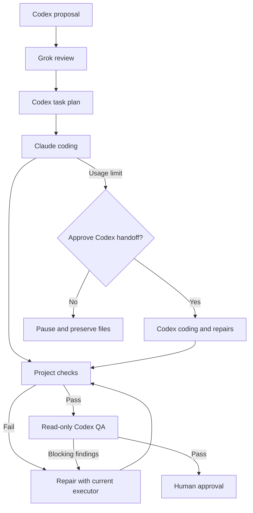

# 贞观·政事堂 · Concord

**English** · [简体中文](README.zh-CN.md)

A native Claude Code plugin for a multi-model development workflow: **Codex proposes and plans, Grok reviews, Claude implements, project checks and read-only Codex QA verify the result, and you approve it.**

**[v0.4.0 is released](https://github.com/radowitz/concord-plugin/releases/tag/v0.4.0).** Install through the GitHub marketplace or download the [self-contained plugin ZIP](https://github.com/radowitz/concord-plugin/releases/download/v0.4.0/concord-v0.4.0.zip). This version adds an optional, consented handoff to Codex when Claude reaches its usage limit.

Node.js builtins only. No Python service, daemon, npm install or nested Claude CLI workers.

## Install and update

Requirements: Node.js 18+, Git, a current Claude Code version, and installed/authenticated `codex` and `grok` CLIs. The optional Codex handoff requires **Codex signed in with ChatGPT**; it refuses API-key login.

Inside Claude Code:

```text
/plugin marketplace add radowitz/concord-plugin
/plugin install concord@concord-plugin
```

Or from a terminal:

```bash
claude plugin marketplace add radowitz/concord-plugin
claude plugin install concord@concord-plugin --scope user
```

To update an existing GitHub marketplace installation:

```bash
claude plugin marketplace update concord-plugin
claude plugin update concord@concord-plugin --scope user
```

**Restart Claude Code after installation or update.** User-scope installation loads in future sessions; you do not need to specify a plugin path every time. `concord@concord-local` uses a local marketplace instead: these GitHub update commands do not refresh that local source. Use one installation source to avoid duplicate loading.

## Install the release ZIP

Download [concord-v0.4.0.zip](https://github.com/radowitz/concord-plugin/releases/download/v0.4.0/concord-v0.4.0.zip), verify it against the release's `SHA256SUMS`, and unzip it. From the containing directory:

```bash
claude plugin marketplace add ./concord-v0.4.0
claude plugin install concord@concord-local --scope user
```

Restart Claude Code. The ZIP includes installation instructions, both language guides, pinned workers, the routing sample and the MIT license. Existing `concord-local` users should update their registered local source instead of adding a second copy.

## Quick start

Open your Git project in Claude Code and run:

```text
/concord:run add server-side validation to the signup form
/concord:run                    # use the task already discussed in this conversation
/concord:status                 # progress, requested models, checks and next action
/concord:logs                   # live or completed provider/check output
/concord:resume latest          # inspect/recover after a restart; no silent retry
/concord:takeover               # prepare a Codex handoff and ask for your decision
```

You do not need `/concord:run` on every follow-up. Requirement changes are recorded by the host following the skill; this plugin registers no chat hooks, so that behaviour depends on the host. Scope changes go through renewed Grok review and planning.

`--test` is optional. Concord detects suitable `test`, `check`, `typecheck`, `lint` and `build` scripts from the nearest `package.json` and package-manager metadata. If it cannot find a reliable check, it asks. For another project type, supply an actual check, for example:

```text
/concord:run --test 'python3 -m pytest -q' fix the job queue race
```

## Workflow and roles



| Institution | Agent | Responsibility |
| --- | --- | --- |
| 中书省 | Codex | Understand the request and propose a solution |
| 门下省 | Grok | Independently review the proposal |
| 尚书省 | Codex | Plan tasks and dependencies |
| 六部 | Claude; Codex after consent | Implement tasks and repairs |
| 吏部选才 | Local routing logic | Select the requested model and effort from task difficulty/risk |
| 御史台 | Read-only Codex QA + project checks | Review changes and verify results |
| 天子 | You | Accept the result and decide whether to publish |

These are organizational metaphors. Implementation is **serial in the current checkout**; the plugin does not create parallel worktrees. A dirty checkout is allowed: existing staged, unstaged and untracked work is snapshotted as the baseline and must be preserved. `--require-clean` opts into a clean-only start. Runs are bound to their original worktree.

## Model routing

| Task | Default Claude request |
| --- | --- |
| Low difficulty and low risk | `haiku` alias |
| Ordinary work | `sonnet` alias |
| Complex or high-risk work | **Fable 5.2 / high** |
| Declared backup for the hard tier | **Opus 5.5 / xhigh**, with a recorded explicit switch |

This is the default policy preference, not a benchmark. Packaged agents pin the exact Fable/Opus IDs and effort; aliases follow Claude Code's mapping. The helper records what it requested, not an observed native model ID. Overrides and per-user profiles are described in the [detailed guide](plugins/concord/README.md#model-routing).

Codex handoff routing uses a separate **low / normal / high** table from the account CLI's model metadata and declared reasoning levels. Selection uses explicit overrides or labelled heuristics from provider descriptions, not version-number ranking. The table, its source and timestamp are shown before consent and frozen for that handoff. Discovery refreshes candidates; it never silently replaces your chosen models.

## When Claude reaches its usage limit

The default option is `--on-claude-limit ask`. A reported usage-window limit pauses the run and asks whether Codex should finish its remaining tasks and repairs. `--on-claude-limit stop` pauses without offering a switch:

```text
/concord:run --on-claude-limit ask implement the feature
/concord:run --on-claude-limit stop implement the feature
```

- **Approve:** continue the same run with the displayed Codex model table, keeping completed tasks, dependencies, partial edits and checks. Failed checks or blocking QA findings return to Codex for bounded repair.
- **Decline or give no answer:** keep the run open and its files intact. No switch occurs. A temporary rate limit instead gives wait/resume guidance; authentication, connection and test failures are not treated as usage-window limits.
- **Changed request or plan, or unexpected checkout changes before execution:** obtain a fresh proposal and consent. Handoff approval is separate from final result approval.

If the **Claude main session itself is blocked**, it may be unable to ask or invoke any skill. Nothing pops up automatically. Start/status output includes a ready-to-copy terminal command using the installed helper's absolute path:

```bash
node /absolute/plugin/scripts/concord.mjs takeover <run-id> --writer-stopped --drive --repo /absolute/project
```

Use the printed command rather than guessing paths. Stop or await the previous Claude writer first: `--writer-stopped` is your acknowledgement, not something the helper can verify. The terminal shows the proposal; type **`approve`** or **`decline`**. With `--drive`, approval continues the workflow in that terminal and stops at validation or another pause. No daemon is started.

If Codex also hits a limit or cannot complete a step, partial edits are preserved and the run pauses; it does not retry or change models by itself. See [handoff and recovery details](plugins/concord/README.md#claude-usage-limit-and-codex-handoff).

## Checks, logs and approval

Checks and read-only QA must correspond to the same working-state fingerprint. Blocking findings return to the current coding executor; the default repair budget is two rounds. Exhausted repairs, malformed output and timeouts preserve the workspace and logs for inspection. A typecheck/lint/build gate is reported as such, not as a behavioural test.

Use `/concord:logs` for provider stdout/stderr and normalized events. Helper stages appear as labelled background Bash tasks in Claude Code `/tasks`; Codex and Grok remain external CLIs. Codex/Grok steps default to 30 minutes, with configurable limits and live extension. Progress notices do not terminate a stage.

**Final approval records a decision for the validated state. It never automatically commits, merges, pushes or deploys.** Subsequent file changes invalidate validation.

## Verification and versions

**169/169 deterministic offline tests passed**, using fake providers and temporary repositories. Real Codex writing, actual quota recovery and the live question UI have not been verified end to end. Earlier evidence includes a read-only native Fable worker canary and a full workflow with main-session Claude implementation. See the [verification record](docs/verification.md) for the scope and limits of each check.

- **Latest Release / tag / marketplace: [v0.4.0](https://github.com/radowitz/concord-plugin/releases/tag/v0.4.0)** — consented Claude-to-Codex handoff, with a plugin ZIP and SHA-256 checksums attached.
- **Previous Release: [v0.3.0](https://github.com/radowitz/concord-plugin/releases/tag/v0.3.0)** — Fable-first routing; its older archives remain available.
- Changelogs: [English](CHANGELOG.md) · [简体中文](CHANGELOG.zh-CN.md).

## Develop from source

```bash
git clone https://github.com/radowitz/concord-plugin.git
cd concord-plugin
claude --plugin-dir ./plugins/concord
node --test tests/*.test.mjs
```

[Detailed plugin guide](plugins/concord/README.md) · [MIT License](LICENSE)
