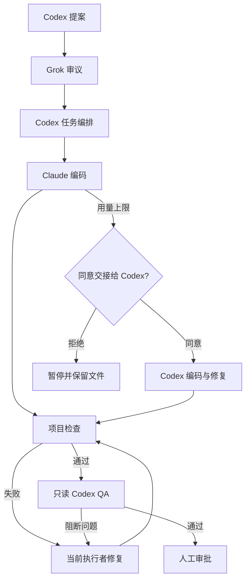

# 贞观·政事堂 · Concord

[English](README.md) · **简体中文**

原生 Claude Code 多模型开发插件：**Codex 起草方案与编排，Grok 独立审议，Claude 编码，项目检查与只读 Codex QA 验证结果，最后由你审批。**

**[v0.4.0 已正式发布](https://github.com/radowitz/concord-plugin/releases/tag/v0.4.0)。** 可通过 GitHub marketplace 安装，或下载[独立插件 ZIP](https://github.com/radowitz/concord-plugin/releases/download/v0.4.0/concord-v0.4.0.zip)。本版新增 Claude 触及用量上限后、经你明确同意交接给 Codex 的选项。

仅使用 Node.js 内置模块，无需 Python 服务、守护进程、npm install 或嵌套 Claude CLI Worker。

## 安装与更新

需要 Node.js 18+、Git、新版 Claude Code，以及已安装并登录的 `codex` 和 `grok` CLI。可选的 Codex 交接要求 **Codex 使用 ChatGPT 登录**，不接受 API Key 登录。

在 Claude Code 内安装：

```text
/plugin marketplace add radowitz/concord-plugin
/plugin install concord@concord-plugin
```

也可以在终端安装：

```bash
claude plugin marketplace add radowitz/concord-plugin
claude plugin install concord@concord-plugin --scope user
```

已通过 GitHub marketplace 安装的用户，运行：

```bash
claude plugin marketplace update concord-plugin
claude plugin update concord@concord-plugin --scope user
```

**安装或更新后重启 Claude Code。** 用户级安装会在后续会话加载，不需要每次指定插件路径。`concord@concord-local` 使用本地 marketplace，上面的 GitHub 更新命令不会更新那个本地来源。请选择一种安装来源，避免重复加载。

## Release ZIP 安装

下载 [concord-v0.4.0.zip](https://github.com/radowitz/concord-plugin/releases/download/v0.4.0/concord-v0.4.0.zip)，对照发布附件 `SHA256SUMS` 校验后解压，在其上级目录运行：

```bash
claude plugin marketplace add ./concord-v0.4.0
claude plugin install concord@concord-local --scope user
```

之后重启 Claude Code。ZIP 包含安装说明、中英文文档、固定模型 Worker、路由样例和 MIT 许可证。已使用 `concord-local` 的用户应更新原来注册的本地来源，避免重复安装。

## 快速开始

在 Claude Code 中打开你的 Git 项目，运行：

```text
/concord:run 为注册表单增加服务端校验
/concord:run                    # 使用当前对话中已经讨论的任务
/concord:status                 # 进度、请求的模型、检查和下一步
/concord:logs                   # 运行中或已完成的模型与检查日志
/concord:resume latest          # 重启后查看和恢复；不会擅自重试
/concord:takeover               # 准备 Codex 交接方案并询问你的决定
```

后续每条消息不必都加 `/concord:run`。需求变化由宿主按 Skill 记录；插件没有注册聊天钩子，因此依赖宿主遵循说明。范围变化会重新经过 Grok 审议与任务编排。

`--test` 是可选项。Concord 根据最近的 `package.json` 和包管理器信息，识别合适的 `test`、`check`、`typecheck`、`lint`、`build` 脚本；找不到可靠检查时会询问。其他类型项目可以提供实际存在的命令，例如：

```text
/concord:run --test 'python3 -m pytest -q' 修复任务队列竞态
```

## 工作流与角色



| 机构 | Agent | 职责 |
| --- | --- | --- |
| 中书省 | Codex | 理解需求、起草方案 |
| 门下省 | Grok | 独立审议方案 |
| 尚书省 | Codex | 拆分任务、编排依赖 |
| 六部 | Claude；经同意后可由 Codex 接手 | 编码与修复 |
| 吏部选才 | 本地路由逻辑 | 根据任务难度和风险选择请求的模型与 effort |
| 御史台 | 只读 Codex QA + 项目检查 | 审核改动、验证结果 |
| 天子 | 你 | 验收结果、决定是否发布 |

这些名称是组织架构类比。当前实现在检出目录中**串行执行**，不会创建并行 worktree。允许带未提交改动启动：已暂存、未暂存和未跟踪的已有工作会被快照为基线，并要求保留。只有显式指定 `--require-clean` 时才要求干净工作区。任务绑定其启动时的工作树。

## 模型路由

| 任务 | 默认 Claude 请求 |
| --- | --- |
| 低难度、低风险 | `haiku` 别名 |
| 普通任务 | `sonnet` 别名 |
| 复杂或高风险任务 | **Fable 5.2 / high** |
| 困难档的声明备选 | **Opus 5.5 / xhigh**，显式切换并记录原因 |

这是默认策略偏好，不是基准测试结论。打包代理固定 Fable/Opus 的精确 ID 与 effort，别名跟随 Claude Code 的映射。助手记录的是请求配置，不是已观测到的原生模型 ID。按次覆盖和用户级配置见[详细说明](plugins/concord/README.zh-CN.md#模型路由)。

Codex 交接使用独立的**低／普通／高**三档模型表，根据账号 CLI 的模型元数据和声明支持的推理强度选择。显式覆盖或带标注的供应商描述启发式判断决定选择，不按版本号排名。模型表、来源和时间在同意前展示，并在本次交接中冻结。发现新候选不会擅自替换已选模型。

## Claude 触及用量上限时

默认选项是 `--on-claude-limit ask`。上报用量窗口耗尽后，任务暂停并询问是否交给 Codex 完成剩余任务与修复；`--on-claude-limit stop` 只暂停、不提供切换询问：

```text
/concord:run --on-claude-limit ask 实现这个功能
/concord:run --on-claude-limit stop 实现这个功能
```

- **同意：** 使用展示的 Codex 模型表继续同一个任务，保留已完成步骤、依赖、部分改动和检查命令。检查失败或 QA 有阻断问题时，由 Codex 在限定轮次内修复。
- **拒绝或没有回答：** 任务保持开放，文件原样保留，不发生切换。临时限流会提供等待和恢复指引；认证、连接与测试失败不会被当作用量窗口耗尽。
- **需求或计划变化，或执行前发现检出状态异常变化：** 重新生成方案并取得同意。交接同意与最终验收审批分开。

如果 **Claude 主会话本身也被限额阻断**，它可能无法询问或运行任何 Skill，不会自动弹出提示。启动和状态输出会提供带已安装助手绝对路径的可复制终端命令：

```bash
node /absolute/plugin/scripts/concord.mjs takeover <run-id> --writer-stopped --drive --repo /absolute/project
```

请复制实际输出的命令，无需猜路径。先停止或等候此前的 Claude 写入者退出；`--writer-stopped` 是你的确认，助手无法自行核实。终端展示方案后，输入 **`approve`** 或 **`decline`**。带 `--drive` 时，同意后在该终端继续执行，直到通过验证或再次暂停，不启动守护进程。

如果 Codex 也触限或无法完成步骤，会保留部分改动并暂停，不会自行重试或切换模型。详见[交接与恢复说明](plugins/concord/README.zh-CN.md#claude-用量上限与-codex-交接)。

## 检查、日志与审批

检查和只读 QA 必须对应同一个工作区指纹。阻断问题退回当前编码执行者，默认最多两轮修复。次数用尽、输出格式错误或超时，会保留工作区和日志供检查。typecheck、lint、build 会按实际类型报告，不会被说成行为测试。

用 `/concord:logs` 查看模型标准输出、错误输出和规范化事件。助手阶段以带名称的后台 Bash 任务出现在 Claude Code `/tasks` 中；Codex、Grok 仍是外部 CLI。每个 Codex/Grok 步骤默认等待 30 分钟，可配置并在运行中延长；进度提示不会终止阶段。

**最终批准只记录针对已验证状态的决定，不会自动提交、合并、推送或部署。** 之后文件再变，验证即失效。

## 验证与版本

**169/169 项离线确定性测试通过**，使用模拟 CLI 和临时仓库。真实 Codex 编码、实际额度恢复及实时询问界面尚未完成端到端验证。历史证据包括只读原生 Fable Worker 冒烟测试，以及由 Claude 主会话编码的完整工作流。各项验证的范围与限制见[验证记录](docs/verification.md)。

- **最新 Release／Tag／marketplace：[v0.4.0](https://github.com/radowitz/concord-plugin/releases/tag/v0.4.0)** — 经同意的 Claude → Codex 交接，附件包含插件 ZIP 与 SHA-256 校验文件。
- **上一版 Release：[v0.3.0](https://github.com/radowitz/concord-plugin/releases/tag/v0.3.0)** — Fable 优先路由，旧版本下载仍保留。
- 更新日志：[English](CHANGELOG.md) · [简体中文](CHANGELOG.zh-CN.md)。

## 从源码开发

```bash
git clone https://github.com/radowitz/concord-plugin.git
cd concord-plugin
claude --plugin-dir ./plugins/concord
node --test tests/*.test.mjs
```

[插件详细说明](plugins/concord/README.zh-CN.md) · [MIT 许可证](LICENSE)
