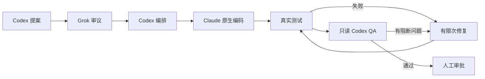

# 贞观·政事堂 · Concord

[English](README.md) · **简体中文**


Claude Code 插件（v0.2.2），在当前会话中运行多模型审议与 QA 流程：Codex 提案与编排，Grok 审议，Claude 原生编码，真实测试裁决，只读 Codex QA 把关。人始终拥有最终决定权。



## 从 GitHub 安装

在 Claude Code 中交互安装：

```text
/plugin marketplace add radowitz/concord-plugin
/plugin install concord@concord-plugin
```

等价的命令行（用户级）：

```bash
claude plugin marketplace add radowitz/concord-plugin
claude plugin install concord@concord-plugin --scope user
```

安装后，插件会在以后的会话中自动加载。

**要求：** Node 18+、Git、Claude Code，以及已登录的 `codex` 和 `grok` CLI。

## 用法

```text
/concord:run 为注册表单增加服务端校验
/concord:run                # 不带参数：使用当前对话中的任务
/concord:status            # 步骤、模型、产物、下一步
/concord:resume latest     # 重启后恢复；不会自动重跑
/concord:logs              # 查看运行中或已结束阶段的 Codex/Grok/测试输出
```

## 架构

| 机构 | Agent | 职责 |
| --- | --- | --- |
| 中书省 | Codex | 理解需求、起草方案 |
| 门下省 | Grok | 独立审议方案 |
| 尚书省 | Codex | 拆分任务、编排依赖 |
| 六部 | Claude | 编码与修复 |
| 御史台 | Codex + 项目检查 | 审核改动、验证结果 |
| 天子 | 你 | 验收结果、决定是否发布 |

这些名称是组织架构类比。当前插件在你的检出目录中串行执行编码任务。

## 设计

- **模型路由：** 按风险为每个任务选择 `haiku`、`sonnet` 或 `opus` 别名（可用 `--tier worker=…` 覆盖）。
- **串行、可在脏工作区开始：** 工作区有未提交改动也可开始；这些改动被快照为基线并原样保留，变更 diff 与快速策略只统计运行期间的新改动，无关的原有工作不计入；若原有缺陷妨碍所请求的结果，QA 仍可将其列为问题。串行实现。需要仅在干净工作区开始时，可显式加 `--require-clean`。
- **自动检测检查命令：** 无需 `--test`。读取最近的 `package.json`（scripts、`packageManager`、npm/pnpm/yarn/bun 锁文件），以 argv 运行 `<pm> run test|check|typecheck|lint|build`，跳过占位与 watch 脚本；找不到可靠命令时会询问而不是放行。仅 typecheck/lint/build 时会如实标注并非测试。`--test` 为可选覆盖。
- **绑定工作树：** 任务绑定其启动时的检出目录。同一仓库的其他 worktree 上的变更型命令会在写入任何内容之前以 `wrong_worktree` 拒绝；只读命令会把该任务标为“外部”，而不是拿错误的文件去比对。
- **检查在预期目录运行：** 显式检查在启动时所在目录运行（根目录命令可用 `tests_cwd`），目录会被记录并显示。规划后若计划文件超出检查可证明覆盖的范围会给出警告；绝不自动加检查，也不声称无法证明的覆盖。
- **任务中途改需求：** 宿主通过内部 `amend` 记录新需求（修订号、历史、使验证失效、保留已有改动；范围变化会先重新经 Grok 审议再重新规划）。Claude Code 支持 `UserPromptSubmit` 钩子，但本插件未注册任何钩子，因此不会自动拦截聊天：只有技能指示宿主、且宿主判断你的消息修改了进行中的任务时才会调用（尽力而为的宿主行为，不保证）。普通聊天不应触发。
- **等待与可见性：** Codex/Grok 每步默认 1800 秒（`0` 为手动等待；运行中可用 `extend` 调整）。每 30 秒的提示只是通知，不会终止步骤。各阶段作为带标签的后台 Bash 任务出现在 `/tasks`；Codex/Grok 仍是外部 CLI，不是原生 Claude 代理。原始 stdout/stderr 与规范化事件（Codex `--json`、Grok `streaming-json`）实时落盘，运行期间即可用 `/concord:logs` 查看。
- **修复路由：** 修复默认继承相关任务中最高的档位（高风险为 Opus），除非指定 `--tier repair=…`。
- **轻量：** 无守护进程、无 Python、无 npm，仅用 Node 内置模块。
- **人工掌控：** 不会自动 commit、push 或部署。
- **验证：** 详见 [验证记录](docs/verification.md)。93 项确定性测试通过；一次真实原生无界面任务约 132 秒完成 Codex → Grok → Codex → Claude 主会话编码 → 项目测试 → Codex QA，已有文件与 HEAD 保持不变。交互面板、原生 Agent 执行和真实长等待控制仍未验证。

## 失败、恢复与审批

检查失败或 QA 有阻断问题时，退回 Claude 修复，再重新运行检查和 Codex QA；默认最多两轮修复。修复次数用尽、模型输出格式错误或超时，会停止任务并保留改动、日志与状态，不会视为通过。

会话重启后，用 `/concord:resume latest` 查看中断的任务；恢复不会擅自重跑模型调用，中断阶段需要明确重试。中途改需求时，直接在当前对话中告诉 Claude，由 Skill 记录修订；范围变更重新经过 Grok 审议与任务编排。这依赖宿主遵循 Skill，并非自动监听每条聊天。

人工批准只记录针对已验证工作区状态的决定，不会开启新一轮编码，也不会自动提交、合并、推送或部署。这些操作需要另行提出；审批后代码再变，必须重新验证。

## 版本

当前版本：**v0.2.2**。各发布版本见 [中文更新日志](CHANGELOG.zh-CN.md) 或 [English changelog](CHANGELOG.md)。更新已安装的插件后，请重启 Claude Code。

## 从源码加载

```bash
git clone https://github.com/radowitz/concord-plugin.git
cd concord-plugin
claude --plugin-dir ./plugins/concord
node --test tests/claude_plugin.test.mjs
```

文档：[插件详细说明](plugins/concord/README.zh-CN.md) · [MIT 许可证](LICENSE)
